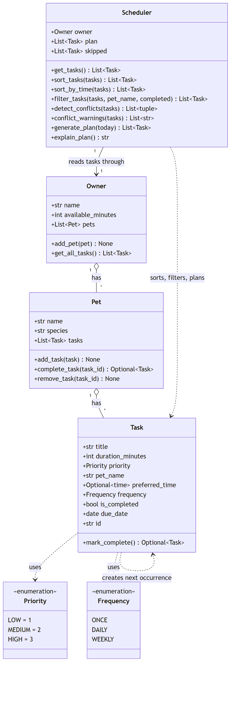

# PawPal+ (Module 2 Project)

You are building **PawPal+**, a Streamlit app that helps a pet owner plan care tasks for their pet.

## Scenario

A busy pet owner needs help staying consistent with pet care. They want an assistant that can:

- Track pet care tasks (walks, feeding, meds, enrichment, grooming, etc.)
- Consider constraints (time available, priority, owner preferences)
- Produce a daily plan and explain why it chose that plan

Your job is to design the system first (UML), then implement the logic in Python, then connect it to the Streamlit UI.

## What you will build

Your final app should:

- Let a user enter basic owner + pet info
- Let a user add/edit tasks (duration + priority at minimum)
- Generate a daily schedule/plan based on constraints and priorities
- Display the plan clearly (and ideally explain the reasoning)
- Include tests for the most important scheduling behaviors

## Getting started

### Setup

```bash
python -m venv .venv
source .venv/bin/activate  # Windows: .venv\Scripts\activate
pip install -r requirements.txt
```

### Suggested workflow

1. Read the scenario carefully and identify requirements and edge cases.
2. Draft a UML diagram (classes, attributes, methods, relationships).
3. Convert UML into Python class stubs (no logic yet).
4. Implement scheduling logic in small increments.
5. Add tests to verify key behaviors.
6. Connect your logic to the Streamlit UI in `app.py`.
7. Refine UML so it matches what you actually built.

## Implementation Summary

PawPal+ is built from four classes in `pawpal_system.py`.

- **Task** is one care activity. It holds a title, duration, priority, preferred time, frequency, and completion status, plus a unique id and the name of its pet.
- **Pet** stores the pet's name and species and keeps its own list of tasks. `add_task` links a task to the pet, and `remove_task` removes one by id.
- **Owner** holds the owner's name, the minutes available each day, and a list of pets. `get_all_tasks()` returns every pet's tasks in one list.
- **Scheduler** is the brain. It reads tasks through `Owner.get_all_tasks()`, so every pet is included, then sorts them (highest priority first, then earliest preferred time, then shortest). It filters out completed tasks and fits as many as possible into the owner's available time. It also detects overlapping preferred times and explains its choices in plain language.

**How they fit together:** an Owner has Pets, a Pet has Tasks, and the Scheduler depends only on the Owner. `generate_plan()` collects all pending tasks, keeps the highest-priority ones that fit in the time available, and records the rest as skipped. `explain_plan()` then reports what was planned, what was skipped and why, and any conflicts. `main.py` shows this end to end with one owner, two pets, and five tasks.

## ✨ Features

Every feature below is implemented in `pawpal_system.py` and covered by the test suite.

| Feature | What it does | Implemented in |
|---|---|---|
| **Multi-pet task tracking** | One owner holds many pets, each pet holds its own tasks. Adding a task stamps it with the pet's name, so any task can say whose it is even after the lists are merged. | `Owner.add_pet()`, `Pet.add_task()`, `Owner.get_all_tasks()` |
| **Sorting by priority (planning order)** | Orders tasks high → medium → low; ties break on earliest preferred time, then on shortest duration. Untimed tasks fall behind timed ones of the same priority. The sort is stable, so identical tasks keep the order you added them in. | `Scheduler.sort_tasks()` |
| **Sorting by time (chronological)** | Orders tasks purely by clock time and ignores priority entirely — this is the "what does my day look like" view. Untimed tasks go last. | `Scheduler.sort_by_time()` |
| **Filtering by pet and status** | Narrows a task list to one pet, to pending-only or done-only, or both at once (the filters AND together). The planner reuses this to exclude completed tasks. | `Scheduler.filter_tasks()` |
| **Conflict detection** | Treats each task as occupying the half-open window `[preferred_time, preferred_time + duration)` and returns every overlapping pair. Back-to-back tasks correctly do **not** conflict. Works within one pet and across different pets. Tasks with no valid time are skipped rather than raising. | `Scheduler.detect_conflicts()` |
| **Conflict warnings** | Turns those pairs into readable sentences that say whether the clash is within one pet or between two, and never raises on bad data. This is advisory only — it warns, it does not move or drop tasks. | `Scheduler.conflict_warnings()` |
| **Daily and weekly recurrence** | Completing a `DAILY` task returns a fresh pending copy due one day later; `WEEKLY` advances seven days. The copy gets a new id, so the completed original stays in the history. `ONCE` tasks simply finish. | `Task.mark_complete()`, `Pet.complete_task()` |
| **Due-date awareness** | The planner only considers tasks due on or before the target day, so a recurring task's next occurrence stays out of today's plan until its date arrives. Overdue tasks are still picked up. | `Scheduler.generate_plan(today=...)` |
| **Greedy time-budgeted planning** | Walks tasks in planning order and takes each one that fits the owner's remaining minutes. A task that doesn't fit is recorded as skipped and the loop continues — so one oversized task can't starve the rest of the day. | `Scheduler.generate_plan()` |
| **Plain-language explanation** | Reports minutes used vs. available, every planned task, every skipped task with its reason, and any conflicts inside the plan. | `Scheduler.explain_plan()` |

**Known limitations** (both deliberately pinned by tests): time windows do not wrap around midnight, and completing an already-completed recurring task will spawn a duplicate occurrence.

## 📐 Final UML

The diagram below matches the shipped code in `pawpal_system.py`. Source: [`diagrams/uml_final.mmd`](diagrams/uml_final.mmd).



An **Owner** aggregates **Pets**, a **Pet** aggregates **Tasks**, and the **Scheduler** holds one Owner and reads every task through it. `Task` depends on the `Priority` and `Frequency` enums, and on itself: a recurring task's `mark_complete()` returns the next occurrence.

## 🖥️ Sample Output

Paste a sample of your app's CLI or Streamlit output here so a reader can see what a generated plan looks like:

```
- Rex: Morning walk (30 min, high) at 07:30
- Mia: Breakfast (10 min, high) at 08:00
- Mia: Medication (5 min, high) at 12:00
- Mia: Play session (20 min, medium) at 18:00
- Skipped Rex: Grooming (40 min, low): not enough time left
```

## 🧪 Testing PawPal+

Run the full suite from the project root:

```bash
python -m pytest
```

### What the tests cover

The suite in `tests/test_pawpal.py` has 34 tests across the behaviors that matter most for a scheduler, split between happy paths and edge cases.

| Area | Happy paths | Edge cases |
|------|-------------|------------|
| **Sorting** | `sort_tasks` applies all three keys in order (priority → preferred time → duration); `sort_by_time` is chronological | Timed tasks sort before untimed ones of the same priority; identical tasks keep insertion order via Python's stable sort; the two sorts deliberately disagree on a low-priority-early vs. high-priority-late pair; empty lists and input-not-mutated |
| **Recurrence** | Completing a `DAILY` task adds one new pending task due the next day with a new id; `WEEKLY` advances seven days | `ONCE` tasks don't recur; weekly recurrence across a month boundary (Jan 28 → Feb 4); unknown task ids are a no-op for both `complete_task` and `remove_task`; completing a task twice recurs twice (documented, see below) |
| **Conflict detection** | Two tasks at the exact same time are flagged; overlapping windows are flagged within one pet and across pets, and labelled accordingly | Back-to-back tasks don't conflict (half-open windows); untimed tasks are ignored; an invalid `preferred_time` warns instead of crashing; zero-duration tasks never conflict; a task running past midnight does not wrap around (documented, see below); empty and single-task lists |
| **Plan generation** | Tasks that fit the budget are all planned; an exact-fit budget leaves nothing skipped; `explain_plan` reports planned minutes, skip reasons and conflicts | A pet with no tasks and an owner with no pets both yield an empty plan; zero available minutes skips everything; an oversized task is skipped but a later shorter task still fits; completed tasks excluded and overdue ones included; re-running `generate_plan` resets prior results |

### Sample test output

```
============================= test session starts =============================
platform win32 -- Python 3.14.3, pytest-9.1.1, pluggy-1.6.0
rootdir: C:\Users\thevi\Project2-PawPal-AI110
plugins: anyio-4.15.1
collected 34 items

tests\test_pawpal.py ..................................                  [100%]

============================= 34 passed in 0.04s ==============================
```

### Confidence level: ★★★★☆ (4 / 5)

Every documented behavior is covered by a passing test, including the empty-state and tie-breaking cases that usually hide bugs, so I'd trust the core scheduling logic. One star is held back for two limitations the tests *document* rather than fix:

- **Midnight wraparound.** `_minutes()` has no modulo, so a 23:50 task lasting 30 minutes never conflicts with a 00:05 task the next morning.
- **Double completion.** `Task.mark_complete()` doesn't check `is_completed`, so completing an already-finished recurring task spawns a duplicate next occurrence from the same `due_date`.

Both are deliberate known behaviors with tests pinning them down, so a future fix will be caught immediately — but until they're resolved the system isn't fully reliable at those boundaries.

## 📐 Smarter Scheduling

| Feature | Method(s) | Notes |
|---------|-----------|-------|
| Task sorting | `Scheduler.sort_tasks()`, `Scheduler.sort_by_time()` | Planning order, and chronological order |
| Filtering | `Scheduler.filter_tasks()` | By pet name and/or completion status |
| Conflict handling | `Scheduler.detect_conflicts()`, `Scheduler.conflict_warnings()` | Overlapping time windows, reported as warnings |
| Recurring tasks | `Task.mark_complete()`, `Pet.complete_task()` | Daily and weekly tasks get a next occurrence |

### Sorting

- **`Scheduler.sort_tasks(tasks)`** orders tasks for planning: highest priority first, then earliest preferred time, then shortest duration. Tasks with no preferred time come after timed tasks of the same priority.
- **`Scheduler.sort_by_time(tasks)`** orders tasks chronologically by `preferred_time` and ignores priority. Tasks with no time go last, and tasks sharing a time keep their original order.
- Both return a new list and leave the input unchanged.

### Filtering

- **`Scheduler.filter_tasks(tasks, pet_name=None, completed=None)`** keeps only matching tasks.
- `pet_name` keeps one pet's tasks. `completed=True` keeps done tasks, `completed=False` keeps pending ones, and `None` does not filter on completion.
- The two filters combine, so `filter_tasks(tasks, pet_name="Rex", completed=False)` returns Rex's pending tasks.
- `generate_plan()` uses it to leave completed tasks out of the plan.

### Conflict detection

- **`Scheduler.detect_conflicts(tasks)`** returns pairs of tasks whose time windows overlap. A task occupies `preferred_time` up to `preferred_time + duration`, so a 30-minute task at 07:30 conflicts with one at 07:45. Back-to-back tasks do not conflict.
- It works within one pet and across different pets. Tasks with no valid `preferred_time` are skipped.
- **`Scheduler.conflict_warnings(tasks)`** turns those pairs into messages and never raises:

  ```
  Warning (different pets): 'Vet call' (Rex, 09:00) overlaps 'Brushing' (Mia, 09:00)
  ```

- This is a lightweight check: it only warns. It does not move or drop tasks, so a plan can still contain a clash. `explain_plan()` includes the warnings for the planned tasks.
- It compares every pair, which is O(n²). That is fine for a day's worth of tasks.

### Recurring tasks

- Each task has a `frequency` of `ONCE`, `DAILY` or `WEEKLY` and a `due_date`.
- **`Task.mark_complete()`** marks the task done. For `DAILY` and `WEEKLY` tasks it returns a fresh pending copy due one day or one week later, with a new id. `ONCE` tasks return `None`.
- **`Pet.complete_task(task_id)`** finds a task by id, completes it, and adds the next occurrence to the pet's tasks.
- `generate_plan(today=None)` only plans tasks whose `due_date` is on or before `today`, so the next occurrence doesn't appear until its day.

### Plan generation

**`Scheduler.generate_plan()`** goes through pending tasks in `sort_tasks` order and adds each one that fits in the owner's remaining minutes. A task that doesn't fit is skipped, but a later, shorter one can still fit. Clock times are not enforced.

## 📸 Demo Walkthrough

### Running it

```bash
streamlit run app.py   # the full app
python main.py         # the CLI demo, no UI needed
```

### The interface

The Streamlit app is a single scrolling page in four parts:

1. **Owner** — your name and how many minutes you have today. The minute budget is the constraint the whole plan is built around.
2. **Pets** — add a pet by name and species. Duplicate names and blank names are rejected with an inline message.
3. **Tasks** — add a care task with a title, duration, priority, repeat rule (`once` / `daily` / `weekly`), and an optional preferred time. Clearing the "Set a preferred time" checkbox makes the task untimed, which is how you enter things like "fetch, sometime today."
4. **Build Schedule** — generates today's plan.

Once you have at least one task, three extra controls appear above the task table:

- **Show pet** — all pets, or one.
- **Show status** — all, pending, or done.
- **Order by** — *Priority (planning order)* or *Time of day*. These are the two different sorts, and switching between them on the same list is the clearest way to see that they disagree on purpose.

Below the table you can **mark a task complete**. For a recurring task the app confirms the next due date; for a one-off it says the task doesn't repeat.

### An example workflow

1. Set your available time to **90 minutes**.
2. Add two pets: **Rex** (dog) and **Mia** (cat).
3. Add tasks: Rex's *Morning walk* (30 min, high, 07:30) and *Grooming* (40 min, low, 16:00); Mia's *Breakfast* (10 min, high, 08:00) and *Medication* (5 min, high, 12:00). Add Rex's *Fetch* (15 min, medium) with the time checkbox cleared.
4. Set **Order by** to *Time of day* — the tasks appear 07:30 → 08:00 → 12:00 → 16:00, with the untimed *Fetch* last. Switch to *Priority* and the three high-priority tasks jump to the top regardless of clock time, while *Grooming* drops to the bottom.
5. Set **Show pet** to *Mia* — only her two tasks remain.
6. Add a clash on purpose: Rex's *Vet call* (20 min, 09:00) and Mia's *Brushing* (10 min, 09:00). A yellow warning appears naming both tasks and flagging it as a **different pets** conflict. The green "No scheduling conflicts" banner is gone.
7. Click **Generate schedule**. A green banner reports the minutes used of the 90 available, a table lists the planned tasks, and a second table lists what was skipped. Expand **Why this plan?** for the reasoning in plain English.
8. Mark *Morning walk* complete. Because it repeats daily, the app confirms the next occurrence's date — and that new task will **not** appear in today's plan, because it isn't due yet.

### Key Scheduler behaviors on display

| Behavior | Where you see it |
|---|---|
| Two different sorts, deliberately disagreeing | The **Order by** dropdown in step 4 |
| Filtering, combining pet and status | **Show pet** / **Show status** in step 5 |
| Conflict warnings labelled by same-pet vs. different-pets | The warning banner in step 6 |
| Greedy budget fitting, and skip-and-continue | The planned and skipped tables in step 7 — *Grooming* (40 min) is skipped while shorter, later tasks still fit |
| Daily recurrence plus due-date filtering | The completion message in step 8 |

### Sample CLI output

`python main.py` runs the same logic headless, with one owner, two pets and six tasks added deliberately out of order:

```
As added (out of order)
-----------------------
   16:00  Grooming       Rex    40 min  [low   ] todo
any time  Fetch          Rex    15 min  [medium] todo
   07:30  Morning walk   Rex    30 min  [high  ] done
   18:00  Play session   Mia    20 min  [medium] done
   12:00  Medication     Mia     5 min  [high  ] todo
   08:00  Breakfast      Mia    10 min  [high  ] todo

sort_by_time
------------
   07:30  Morning walk   Rex    30 min  [high  ] done
   08:00  Breakfast      Mia    10 min  [high  ] todo
   12:00  Medication     Mia     5 min  [high  ] todo
   16:00  Grooming       Rex    40 min  [low   ] todo
   18:00  Play session   Mia    20 min  [medium] done
any time  Fetch          Rex    15 min  [medium] todo

sort_tasks (priority, then time, then length)
---------------------------------------------
   07:30  Morning walk   Rex    30 min  [high  ] done
   08:00  Breakfast      Mia    10 min  [high  ] todo
   12:00  Medication     Mia     5 min  [high  ] todo
   18:00  Play session   Mia    20 min  [medium] done
any time  Fetch          Rex    15 min  [medium] todo
   16:00  Grooming       Rex    40 min  [low   ] todo

filter_tasks: pet_name='Rex'
----------------------------
   16:00  Grooming       Rex    40 min  [low   ] todo
any time  Fetch          Rex    15 min  [medium] todo
   07:30  Morning walk   Rex    30 min  [high  ] done

filter_tasks: completed=True
----------------------------
   07:30  Morning walk   Rex    30 min  [high  ] done
   18:00  Play session   Mia    20 min  [medium] done

filter_tasks: pet_name='Mia', completed=False, sorted by time
-------------------------------------------------------------
   08:00  Breakfast      Mia    10 min  [high  ] todo
   12:00  Medication     Mia     5 min  [high  ] todo

Conflict check before adding a clash
------------------------------------
No conflicts.

Conflict check after adding two tasks at 09:00
----------------------------------------------
Warning (different pets): 'Vet call' (Rex, 09:00) overlaps 'Brushing' (Mia, 09:00)

Today's plan (90 min available)
-------------------------------
   08:00  Breakfast      Mia    10 min  [high  ] todo
   09:00  Vet call       Rex    20 min  [medium] todo
   09:00  Brushing       Mia    10 min  [low   ] todo
   12:00  Medication     Mia     5 min  [high  ] todo
any time  Fetch          Rex    15 min  [medium] todo

Why this plan:
Planned 60 of 90 available minutes (highest priority first, then earliest preferred time, then shortest).
- Mia: Breakfast (10 min, high) at 08:00
- Mia: Medication (5 min, high) at 12:00
- Rex: Vet call (20 min, medium) at 09:00
- Rex: Fetch (15 min, medium)
- Mia: Brushing (10 min, low) at 09:00
- Skipped Rex: Grooming (40 min, low): not enough time left
Warning (different pets): 'Vet call' (Rex, 09:00) overlaps 'Brushing' (Mia, 09:00)
```

Three things worth noticing in that output:

- **The two sorts genuinely differ.** `sort_by_time` puts *Grooming* (16:00, low) fifth; `sort_tasks` puts it dead last behind an untimed medium task.
- **The plan is not conflict-free.** *Vet call* and *Brushing* both landed at 09:00 and both got planned. The scheduler warns rather than resolving — it has no authority to move your vet appointment.
- **Skipping doesn't stop the loop.** *Grooming* needed 40 minutes and only 30 remained, so it was skipped — but *Fetch* (15 min) still fit afterwards.
